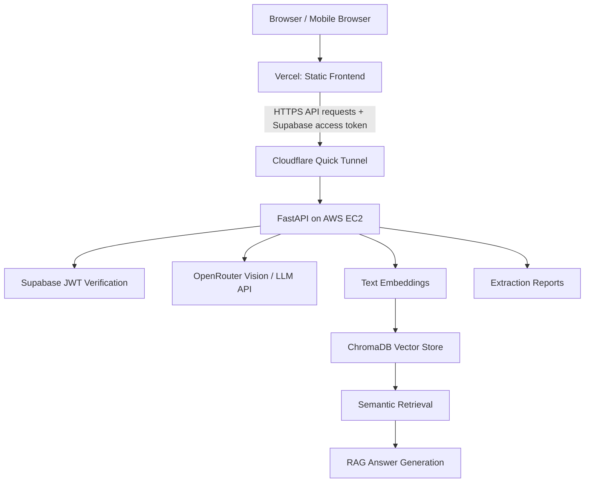

# Vision Data Extractor

**A multimodal AI application for extracting structured information from images, indexing extracted content, and asking questions about it.**

[](https://www.python.org/)
[](https://fastapi.tiangolo.com/)
[](https://supabase.com/)
[](https://www.trychroma.com/)
[](https://openrouter.ai/)

> Extract information with a vision-capable model, store searchable representations, and use retrieval-augmented generation (RAG) to ask questions about your content.

**Live application:** [Open Vision Data Extractor](https://vision-data-extractor-frontend-iota.vercel.app/)  
**Source code:** [PUNITH-V/VISION-DATA-EXTRACTOR](https://github.com/PUNITH-V/VISION-DATA-EXTRACTOR)

---

## Features

- **Vision-based extraction:** send images to a vision-capable model through OpenRouter.
- **Structured results:** extract image descriptions and data points into application-defined report structures.
- **Input validation:** validate supported image files before processing.
- **Reports:** access extraction reports through the API and frontend.
- **Embeddings and vector search:** represent extracted content as embeddings and retrieve semantically relevant information using ChromaDB.
- **RAG question answering:** ask questions about indexed content and retrieve relevant context for answers.
- **Authentication:** Supabase-based authentication with JWT verification on protected API routes.
- **User isolation:** user-scoped report storage and filtering for vector retrieval.
- **Health endpoint:** check whether key backend dependencies are configured and reachable.
- **Automated tests:** tests for API behavior, authentication, and search-related workflows.

> Extraction quality, confidence labels, and output-format support depend on the selected vision model. Verify extracted values when accuracy matters.

## Architecture



### Main components

- **Frontend:** standalone HTML, CSS, and JavaScript pages served through Vercel.
- **Backend:** FastAPI application served by Uvicorn on AWS EC2.
- **Authentication:** Supabase authentication on the frontend; the backend validates bearer tokens for protected routes.
- **Vision/LLM calls:** OpenRouter provides access to the configured model.
- **Embeddings and retrieval:** embedding code and ChromaDB support semantic search and RAG.
- **Connectivity:** the current deployment uses a Cloudflare Quick Tunnel to expose the API from EC2.

### Current deployment note

The frontend and backend are deployed separately. The Cloudflare Quick Tunnel URL is temporary and may change if the tunnel is recreated. If it changes, update the frontend runtime API URL and redeploy. For a more permanent production deployment, replace the Quick Tunnel with a stable domain and durable HTTPS setup.

## Technology stack

| Area | Technology |
|---|---|
| Language | Python |
| API | FastAPI |
| ASGI server | Uvicorn |
| Vision and language model access | OpenRouter |
| Authentication | Supabase Auth / JWT |
| Embeddings | Sentence Transformers (as configured by the project) |
| Vector database | ChromaDB |
| Frontend | HTML, CSS, JavaScript |
| Frontend hosting | Vercel |
| Backend hosting | AWS EC2 (Amazon Linux) |
| Tunnel | Cloudflare Quick Tunnel |
| Tests | pytest |

## Repository layout

The repository may evolve as the project changes. Main areas include:

```text
VISION-DATA-EXTRACTOR/
├── api/                    # FastAPI app, routes, dependencies and auth
├── app/                    # Application and RAG orchestration
├── config/                 # Application settings
├── embeddings/             # Embedding model integration
├── input/                  # Local input images (sample/local use)
├── output/                 # Generated reports (local/runtime output)
├── vector_stores/          # Vector-store abstraction and ChromaDB adapter
├── tests/                  # Automated tests
├── scripts/                # Helper and operational scripts
├── vision_extractor_UI/    # Standalone frontend pages and shared JS
├── .env.example            # Environment variable template
├── pytest.ini              # pytest configuration
└── requirements.txt        # Python dependencies
```

Some directories, such as `chroma_data/`, generated reports, local inputs, and virtual environments, may exist only in local or deployed environments. Do not commit generated or private data.

## Getting started locally

### 1. Prerequisites

- Python compatible with `requirements.txt`.
- Git.
- An OpenRouter API key.
- A Supabase project if testing authenticated routes and frontend login.
- Required environment variables configured locally.

### 2. Clone the repository

```bash
git clone https://github.com/PUNITH-V/VISION-DATA-EXTRACTOR.git
cd VISION-DATA-EXTRACTOR
```

### 3. Create and activate a virtual environment

**Windows PowerShell**

```powershell
python -m venv venv
.\venv\Scripts\Activate.ps1
```

**Linux / macOS**

```bash
python3 -m venv venv
source venv/bin/activate
```

### 4. Install dependencies

```bash
python -m pip install --upgrade pip
pip install -r requirements.txt
```

### 5. Configure environment variables

Copy the template:

**Windows PowerShell**

```powershell
Copy-Item .env.example .env
```

**Linux / macOS**

```bash
cp .env.example .env
```

Edit `.env` and supply the values required by your configuration. Common settings include:

```dotenv
OPENROUTER_API_KEY=your_server_side_openrouter_key
OPENROUTER_MODEL=your_vision_capable_openrouter_model
AUTH_ENABLED=true
SUPABASE_URL=your_supabase_project_url
# Add other variables documented in config/settings.py and .env.example.
```

These are illustrative placeholders. `.env.example` and `config/settings.py` in the repository are the source of truth for the exact required settings.

**Security rules**
- Never commit `.env`.
- Never put `OPENROUTER_API_KEY`, Supabase service-role keys, or Supabase JWT secrets in browser code.
- Supabase project URL and publishable/anon key are intended for browser use, but correct Supabase policies and backend authorization are still required.
- Do not paste secrets into issues, logs, screenshots, or chat messages.
- Use separate credentials for development and production where practical.

### 6. Start the backend

From the repository root, with the virtual environment activated:

```bash
python -m uvicorn api.server:app --reload --port 8000
```

The backend should be available at:

- API base: `http://127.0.0.1:8000`
- Health check: `http://127.0.0.1:8000/api/health`
- OpenAPI documentation (if enabled): `http://127.0.0.1:8000/docs`

The health endpoint reports service status; a healthy response does not guarantee every external model request will succeed.

### 7. Serve the frontend locally

In a second terminal:

```bash
cd vision_extractor_UI
python -m http.server 5500
```

Open `http://127.0.0.1:5500` in a browser. Ensure the shared frontend configuration points to the backend API URL you intend to use. If authentication is enabled, configure the public Supabase URL and publishable/anon key as expected by the frontend.

> Serve the HTML pages over HTTP rather than opening them directly as `file://` URLs.

## Running tests

From the repository root, activate the virtual environment and run:

```bash
pytest
```

For a verbose report:

```bash
pytest -v
```

Tests that require external services or credentials may need suitable test configuration. Passing unit/integration tests does not prove a live Supabase or OpenRouter account is configured correctly; verify those separately.

## API overview

The project includes routes for health checks, image extraction, reports, ingestion, search, and question answering. Exact schemas and route behavior are defined in the API source and OpenAPI documentation.

| Route | Purpose |
|---|---|
| `GET /api/health` | Health/status check |
| `POST /api/extractions` | Submit an image for extraction |
| `GET /api/reports` | List accessible reports |
| Ingestion routes under `/api/` | Index content for retrieval |
| Search routes under `/api/` | Retrieve semantically relevant content |
| Ask routes under `/api/` | Ask questions over indexed content |

Protected routes require a valid bearer token when authentication is enabled. Confirm request payloads and response schemas using the OpenAPI docs or route source files.

## Deployment overview

### Frontend — Vercel

1. Connect the GitHub repository or its frontend project root to Vercel.
2. Ensure the configured root directory points to the folder containing the frontend pages.
3. Include all shared frontend scripts and runtime configuration in the deployment.
4. Configure the production API base URL and public Supabase frontend settings.
5. Redeploy and test login, extraction, reports, search, and question answering.

### Backend — AWS EC2

The backend runs on Amazon Linux and is managed by a `systemd` service named `vision-extractor`.

```bash
sudo systemctl status vision-extractor --no-pager
sudo systemctl is-active vision-extractor
sudo systemctl restart vision-extractor
sudo journalctl -u vision-extractor -n 50 --no-pager
```

The Cloudflare tunnel is managed by `cloudflared-quick-tunnel`:

```bash
sudo systemctl status cloudflared-quick-tunnel --no-pager
sudo systemctl is-active cloudflared-quick-tunnel
sudo journalctl -u cloudflared-quick-tunnel -n 50 --no-pager
```

`restart` briefly interrupts a service. Inspect status and logs before restarting during an incident.

### Troubleshooting

- **Frontend says “Network error”:** check the configured API base URL, browser console/network tab, CORS settings, and tunnel status.
- **`shared/config.js` returns 404:** verify Vercel's project root and confirm the file is included in the deployment. Check `.gitignore` and Git tracking.
- **API returns 502 during extraction:** inspect backend logs. The request may have reached FastAPI but failed at the model provider due to quota, rate limits, provider outage, or an invalid model response.
- **Health endpoint succeeds but extraction fails:** health checks may not make a real vision-model call; inspect extraction-specific logs.
- **401/403:** check whether the frontend sends the current Supabase access token and whether backend JWT settings match the project.
- **Service inactive:** inspect `systemctl status` and `journalctl` before changing configuration.
- **Tunnel URL changed:** update the frontend runtime API URL and redeploy.

## Security and privacy

- Keep server-side secrets in environment variables or a suitable secrets manager.
- Do not commit `.env`, private uploads, generated reports containing personal information, database files, or credentials.
- Keep authentication enabled in deployments exposing user-specific data.
- Enforce authorization on the server; hiding frontend controls is not access control.
- Keep user data separated in report storage and vector retrieval.
- Review logs before sharing them; logs can contain user identifiers, filenames, or operational details.
- Configure CORS for intended frontend origins only.
- Use HTTPS for public access and rotate any secret that has been exposed.

## Limitations and considerations

- Free model availability and rate limits can change; a model working today may throttle or become unavailable later.
- Vision extraction can misread charts, small text, ambiguous labels, or low-resolution images. Validate critical values against the source image.
- The current Quick Tunnel is convenient for a project/demo but is not a stable permanent endpoint.
- Local ChromaDB data and generated reports need deliberate persistence and backup planning for production.
- External-service tests should be run separately from deterministic unit tests.

## Roadmap

Potential improvements:

- Replace the Quick Tunnel with a stable domain and managed HTTPS endpoint.
- Add Docker-based reproducible deployment.
- Add automated CI checks for tests, linting, and dependency/security scanning.
- Add structured logs, request IDs, metrics, and alerting.
- Add retry/backoff and user-friendly handling for model-provider throttling.
- Document backup and restore procedures for ChromaDB and reports.
- Add end-to-end tests against a dedicated test environment.

## Contributing

Issues and pull requests are welcome. For a useful bug report, include:
- What you tried to do.
- Expected versus actual behavior.
- Relevant redacted logs and reproduction steps.
- Environment details that do not reveal secrets.

Do not attach private images or credentials.

---

**Built as a practical multimodal AI engineering project:** image understanding, structured extraction, embeddings, vector retrieval, RAG, authentication, testing, and deployment.
